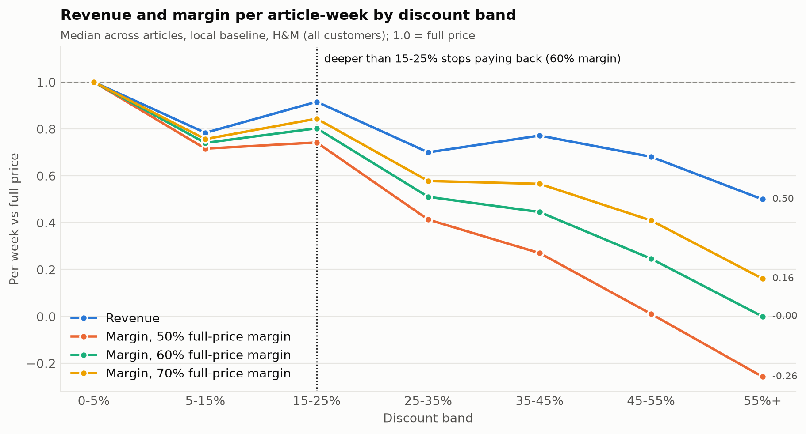

# Discount & Demand Analytics for Fashion E-commerce

Pricing, customer and demand analytics on 31.8M H&M fashion transactions and
1.06M Myntra listings: where deeper markdowns stop paying back, who is about to
churn and what to offer them, how demand will move, and how far product tagging can be automated.

> **Key results**
> * **Markdown ceiling: 15-25% (about 20% off).** No discount
>   band beat full-price margin per article-week; once an item is marked down, going deeper
>   than 15-25% cut margin sharply (same band under 50-70% margin assumptions).
> * **Forecasting:** Prophet + promo forecasts 12 weeks ahead at **23.3% MAPE vs 30.4%** for a seasonal-naive baseline (WAPE 20.1% vs 25.2%), winning in
>   4 of 8 categories.
> * **Product tagging:** 97.9% category and 89.1% product-type accuracy on
>   held-out styles; timed review vs manual tagging saved **[TBD]** of the effort.
> * **Customers:** 546,270 churned or at-risk customers with
>   **113.8M indexed revenue at stake**; win-back offers capped at the markdown ceiling.



Power BI dashboard: [TBD] (built from the export with [`dashboard/BUILD_GUIDE.md`](dashboard/BUILD_GUIDE.md)).

---

## Business questions and answers

**1. Discount payback: at what depth do deeper markdowns stop paying back?**
Across 104,547 articles, discounted weeks sold about as many units as the
same article's full-price weeks nearby (elasticity -0.08, 95% CI
-0.09 to -0.07, with article, week and article-age effects), so
no band beat full price on margin (best band vs full price: 0-5%). Among discount
levels, margin per week peaks in the **15-25%** band (index 0.80
of full-price margin) and falls from 25-35% onwards. Myntra's cross-sectional revenue
proxy also peaks at 15-25%.
→ [notebook](notebooks/02_discount_payback.ipynb) ·
[pricing recommendation](reports/pricing_recommendation.md)

**2. Performance KPIs: how are revenue, orders, AOV and units moving?**
Monthly revenue, orders, AOV and customers with month-on-month change, category mix and the top
20 articles and styles. Weekly sales peak in late June and late November; about
32% of revenue is sold at a discount.
→ [notebook](notebooks/03_kpis_and_rfm.ipynb) · Power BI dashboard: [TBD] (built from the export with [`dashboard/BUILD_GUIDE.md`](dashboard/BUILD_GUIDE.md)).

**3. Customer health: who is high-value, at risk or lost, and what should we do?**
1,362,281 customers scored on recency, frequency and monetary value into nine
segments. Champions and Loyal customers are 34% of customers but
78% of revenue. The churned and at-risk segments hold
546,270 customers (40%) and 113.8M indexed revenue at
stake; each gets an action, channel, timing and KPI, with offers capped at 20%.
Average month-1 repeat rate: 24%.
→ [notebook](notebooks/03_kpis_and_rfm.ipynb) · [win-back playbook](reports/winback_playbook.md)

**4. Demand planning: weekly demand for the top categories over the next 12 weeks.**
Prophet with yearly seasonality (with and without a promo-intensity regressor), backtested over
4 rolling 12-week folds (2019-10-21 to 2020-09-14) against a seasonal-naive baseline. Best spec:
Prophet + promo, MAPE 23.3% / WAPE 20.1% vs 30.4% /
25.2% for the baseline. It beats the baseline in Garment Lower body, Garment Upper body, Shoes and Underwear, not in the
other categories, and its 80% intervals cover 60% of actuals.
→ [notebook](notebooks/04_forecasting.ipynb)

**5. Catalogue ops: can a model tag products well enough to replace most manual tagging?**
A TF-IDF + logistic regression tagger trained on 105,542 H&M articles (XGBoost was
compared and came close), split by style to avoid leakage. On 21,112 held-out
articles: category 97.9% (baseline 40.0%), product type
89.1% (baseline 10.2%), pattern 64.2%, colour 34.3%
(texts rarely name the colour). Auto-accepting suggestions at ≥90% confidence covers
94% of products for category at 99.3% accuracy, and
70% for product type at 96.8%. Timed effort saving:
[TBD].
→ [notebook](notebooks/05_product_tagging.ipynb)

---

## Data

| Dataset | Use | Source and licence |
|---|---|---|
| H&M Personalized Fashion Recommendations | 31,788,324 transactions, 1.36M customers, 2018-09-20 to 2020-09-22; article labels for tagging | Kaggle competition `h-and-m-personalized-fashion-recommendations`, non-commercial / academic use. Accept the rules on Kaggle once. |
| Myntra products | 1.06M listings (price, MRP, rating count); discount cross-check and tagging | Kaggle dataset `ronakbokaria/myntra-products-dataset` (May 2023 snapshot). |

No raw data is committed: `make data` downloads it. H&M prices are normalised, so revenue is
**indexed revenue** (price × a fixed factor).

## Methods and limitations

* **Discounts.** Reference price = 95th percentile of an article's price over a trailing 8-week
  window; discount = 1 − price ÷ reference. Band indexes compare each article with its own
  full-price weeks within ±8 weeks (not over the article's whole life,
  because markdowns come late in an article's life; the lifetime version is reported as a
  sensitivity check). Elasticity uses article, week and article-age fixed effects.
* **Customers.** RFM scores by percentile rank (ties share a score); churn = no purchase in
  120 days, with 90 and 180 shown; an order = one customer, one day, one channel.
* **Forecasting.** Rolling-origin backtest, MAPE and WAPE by horizon, always against a
  seasonal-naive baseline.
* **Tagging.** TF-IDF text features with logistic regression and XGBoost, run
  locally at no cost; train / test split by style.
* **Limitations.** Markdowns are not randomised, so discount results are associations, not
  causal effects; there is no cost data (margins are 50/60/70% scenarios) and no inventory
  data; weeks with zero sales are unobserved; under two years of history for yearly
  seasonality, and the forecast test window includes the 2020 store closures; colour cannot be
  tagged from text; Myntra titles are much shorter than H&M descriptions.

## Reproduce

```bash
make setup                      # Python 3.11 venv + dependencies + pre-commit
cp .env.example .env            # Kaggle credentials (or ~/.kaggle/kaggle.json)
make all                        # dev mode: 10% customer sample, minutes
FDDA_MODE=full make all         # final numbers on all data
.venv/bin/python -m fdda.report.readme   # regenerate this README from reports/
make test && make lint
```

`config/settings.yaml` holds every parameter (paths, seed, bands, windows, horizons).
Product tagging also needs the OpenMP runtime on macOS (`brew install libomp`) for XGBoost.

## Repo map

```
config/settings.yaml      all parameters
src/fdda/data/            download + clean (DuckDB -> Parquet)
src/fdda/features/        reference price, discount bands, RFM
src/fdda/analysis/        EDA, discount payback, KPIs, cohorts, win-back, memo
src/fdda/forecast/        weekly series, Prophet, backtest
src/fdda/tagging/         TF-IDF + XGBoost / logistic regression tagger, effort study
src/fdda/export/          Power BI star schema
src/fdda/report/          this README and the resume bullets
notebooks/01-05           narrative notebooks (they only call src/)
reports/                  tables, figures, pricing memo, win-back playbook
dashboard/                DAX measures, build guide, theme, data dictionary
tests/                    pytest suite on a synthetic fixture
```

## What I'd do next

* **A/B test the markdown ceiling:** randomise 0 / 10 / 20 / 30% markdowns across matched stores
  or customer cohorts for articles at the same lifecycle stage.
* **Price optimisation** with inventory and cost data, valuing clearance properly.
* **Hierarchical forecasting** (category → product type → article) with a longer history.
* **Image-based tagging** for colour and pattern.

*I build this README with `python -m fdda.report.readme` from the files in `reports/`, so every
number matches the analysis; values not measured yet show [TBD].* · [Repository](https://github.com/wajeehkhanm-ship-it/fashion-discount-demand-analytics)
